  

  <a href="https://www.linkedin.com/in/sathiyanarayananl/"><strong>LinkedIn</strong></a>
  &nbsp;&nbsp;·&nbsp;&nbsp;
  <a href="#selected-projects"><strong>Projects</strong></a>
  &nbsp;&nbsp;·&nbsp;&nbsp;
  <a href="https://github.com/sathiyalabs?tab=repositories"><strong>Repositories</strong></a>

## About me

I'm **Sathiya**, a first-year **B.Tech Computer Science and Engineering student at SRMIST**, based in Chennai. I’m strengthening my foundations in **C, Python, data structures, and algorithms** while exploring software engineering and AI/ML through practical projects.

I use AI tools to explore ideas, learn, and build, alongside studying the fundamentals behind the code. My projects span frontend interfaces, team formation, and machine learning for code analysis.

## Selected projects

<table>
  <tr>
    <td width="50%" valign="top">
      <h3><a href="https://github.com/sathiyalabs/Varnamgifts">Varnam Gifts</a></h3>
      
A festive gift catalogue with searchable collections, animated product cards, smooth scrolling, and product-specific WhatsApp enquiry drafts. Features 12 products across four collections and reduced-motion support.

      
<strong>Next.js · React · Tailwind CSS · Framer Motion · GSAP · Lenis</strong>

      
<a href="https://varnam-gifts-motion.thanish3475.chatgpt.site/">Live demo →</a> &nbsp;·&nbsp; <a href="https://github.com/sathiyalabs/Varnamgifts">Source code →</a>

    </td>
    <td width="50%" valign="top">
      <h3><a href="https://github.com/sathiyalabs/impactgraph-ai">ImpactGraph AI</a></h3>
      
Explores bug-fix risk in Git commits by combining code-change metrics with dependency-graph features and a Random Forest classifier.

      
<strong>Python · scikit-learn · NetworkX · Flask</strong>

      
<a href="https://github.com/sathiyalabs/impactgraph-ai">Explore source →</a>

    </td>
  </tr>
  <tr>
    <td width="50%" valign="top">
      <h3><a href="https://github.com/sathiyalabs/projectmatch">ProjectMatch</a></h3>
      
A team formation prototype that identifies capability gaps and explores which candidates could complement an existing team.

      
<strong>React · TypeScript · Express · Gemini</strong>

      
<a href="https://github.com/sathiyalabs/projectmatch">Explore source →</a>

    </td>
    <td width="50%" valign="top">
      <h3><a href="https://github.com/sathiyalabs/Milan-">Milan ’26</a></h3>
      
A cultural festival frontend prototype for the SRMIST DSA tech team selection task, with event filtering, form validation, and demo registration.

      
<strong>React · TypeScript · Tailwind CSS · Vite</strong>

      
<a href="https://github.com/sathiyalabs/Milan-">Explore source →</a>

    </td>
  </tr>
</table>

## Learning & tools

| Area | Focus |
| :--- | :--- |
| **Fundamentals** | C · Python · Data structures & algorithms · Problem-solving |
| **Web projects** | React · TypeScript · Tailwind CSS · Vite |
| **Data & ML projects** | pandas · scikit-learn · NetworkX · Flask |
| **Development workflow** | Git · GitHub · Linux |

My current priorities are to practise problem-solving consistently, understand the code I build, and improve project quality through validation, testing, and documentation.

---

  <strong>Connect with me</strong> 
  Happy to connect with fellow students and developers for projects, hackathons, and learning.  
  <a href="https://www.linkedin.com/in/sathiyanarayananl/">Find me on LinkedIn →</a>

